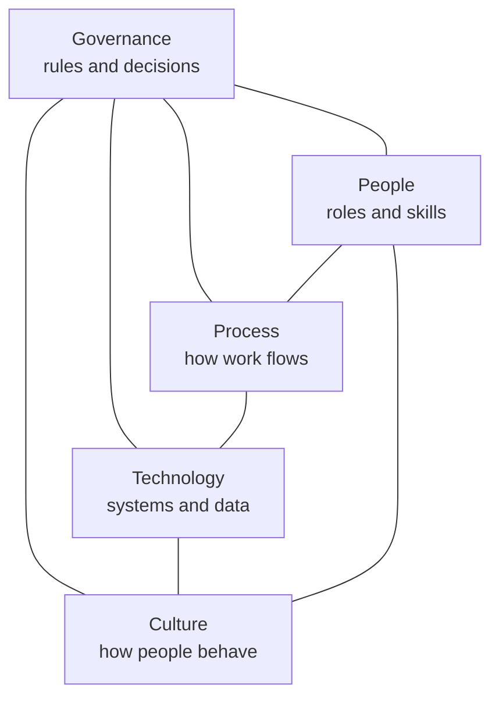

# 2. The five dimensions

AI governance is not only a policy document. It touches five dimensions of an organisation, and a gap in any one of them weakens the rest.

| Dimension | The question it answers | What good looks like | Typical gap |
|---|---|---|---|
| **Governance** | Who decides, and by which rules? | An approved AI policy, a named owner for AI governance, an AI register, a decision forum | AI is used but nobody owns the overall picture |
| **People** | Do people have the roles and skills they need? | Clear roles and a RACI, AI literacy matched to each role, trained human overseers | Everyone uses AI, nobody has been trained |
| **Process** | Is governance built into how work flows? | Intake, classification, approval and review steps inside existing processes like procurement and delivery | Governance is a separate track people skip |
| **Technology** | Are systems and data under control? | Known inventory of AI tools, logging, access control, vendor documentation, monitoring | Shadow AI: tools nobody approved, data going to unknown places |
| **Culture** | Do people behave responsibly when nobody is checking? | People question outputs, report problems early and know it is safe to do so | Silent workarounds, blind trust in outputs |

## Using the dimensions

- **As a health check.** Rate each dimension from 1 (absent) to 5 (embedded and improving). The lowest score is usually the best place to start.
- **As a design checklist.** When you introduce a new control, ask which dimension it lives in and whether it needs support from the others. A new approval step (Process) fails without someone trained to approve (People) and a place to record the decision (Technology).
- **As a structure for reporting.** Report progress to management per dimension, not per document.

> The scored maturity assessment with detailed questions per dimension is part of the advisory engagement and is not included in this repository.
