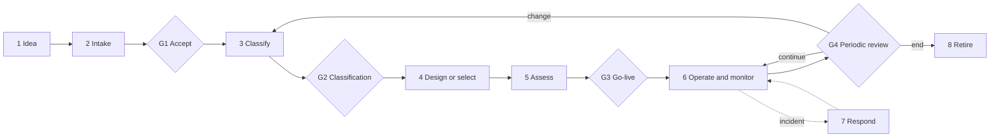

# 4. The AI use case lifecycle

Every AI use case moves through the same eight stages, from an idea to retirement. Five gates decide whether it moves on. How heavy each gate is depends on the [governance intensity](03-oversight-scale.md#governance-intensity).

## Stages

| # | Stage | What happens | Output |
|---|---|---|---|
| 1 | **Idea** | Someone sees a use for AI. | A one-line description |
| 2 | **Intake** | The use case owner fills in the intake form: purpose, users, data, vendor, expected oversight level. | [Use case intake](../templates/use-case-intake.md), entry in the [AI register](../templates/ai-register.csv) or the [AI Use Case Register](https://ai-use-case-register.streamlit.app) |
| 3 | **Classify** | Determine the role (deployer or provider), the EU AI Act risk tier and the oversight level. Together they give the governance intensity. Check which other laws apply (GDPR, NIS2, DORA). | Classification on record, intensity set. Tools: [EU AI Act Risk Check](https://ai-act-risk-check.streamlit.app), [Regulation Navigator](https://regulation-navigator.streamlit.app) |
| 4 | **Design or select** | Build the solution or pick the vendor. For bought tools: check the vendor's documentation, data processing terms and instructions for use. Financial entities also check the DORA contract terms. | Vendor or design decision. Tool: [AI Contract Clause Checker](https://contract-clause-checker.streamlit.app) |
| 5 | **Assess** | Assessments required by the intensity: DPIA, fundamental rights impact assessment, testing, plan for human oversight. | [AI system record](../templates/ai-system-record.md) |
| 6 | **Operate and monitor** | Run the system, keep logs, review samples and exceptions as set by the oversight level, train users. | Monitoring notes, log retention, register health check in the [AI Use Case Register](https://ai-use-case-register.streamlit.app) |
| 7 | **Respond** | Something goes wrong. Contain it, inform the right people, learn from it. | [Incident report](../templates/incident-report.md), every reporting deadline in the Incident Clock of the [Regulation Navigator](https://regulation-navigator.streamlit.app) |
| 8 | **Retire** | Switch off, inform users, keep records for the required period, update the register. | Register entry closed |

## Gates

| Gate | Question | Light | Standard | Enhanced | Strict |
|---|---|---|---|---|---|
| **G1 Accept** | Is this worth pursuing and allowed by our policy? | Self-check | Governance lead | Governance lead | Governance lead |
| **G2 Classification** | Do we agree on role, risk tier and oversight level? | Self-check | Governance lead | Governance lead + legal/DPO | Council |
| **G3 Go-live** | Are the controls in place and tested? | Not needed | Governance lead | Council | Council + management |
| **G4 Periodic review** | Is it still working as intended and still compliant? | Yearly self-check | Yearly | Yearly | Every 6 months |
| **G5 Retirement** | Are records kept and users informed? | Self-check | Governance lead | Governance lead | Governance lead |

## When to go back to classification

Go back to stage 3 when any of these change: the purpose, the group of people affected, the data used, the vendor or model, or the oversight level. A tool that starts as a drafting assistant (level 3) and ends up sending emails by itself (level 5) is a new use case.
