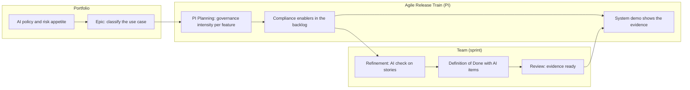

# Agile AI governance playbook

**How to run AI governance inside Scrum and SAFe, instead of as a gate at the end.**

## The problem

In many organisations, AI governance works like this: a team builds or configures an AI feature, then sends it to compliance for review. Compliance finds issues. The release slips, the team is frustrated, and next time they find a way around the review.

The fix is not a faster review. It is to move governance into the cadence the teams already have, so that most questions are answered while the work is being planned and built.

## The idea in one picture

## 1. Portfolio level: decide early

| Practice | How |
|---|---|
| **Classify at the epic** | Every epic that involves AI gets a lean classification before it is approved: role (deployer or provider), EU AI Act risk tier and expected [oversight level](../framework/03-oversight-scale.md). Use the [intake template](../templates/use-case-intake.md) as the epic hypothesis statement's companion. |
| **Governance intensity in the business case** | Strict and enhanced use cases carry real cost (assessments, oversight, monitoring). Put it in the lean business case, so the decision to proceed is made with eyes open. |
| **AI Council as a portfolio stakeholder** | The council takes part in portfolio sync for AI epics, rather than reviewing them after delivery. |

## 2. Release train level: plan it in

### PI Planning

- **Before PI Planning**, the AI governance lead reviews the features coming in and marks each one with its governance intensity.
- **During PI Planning**, teams plan the governance work as normal backlog items. A strict feature without assessment enablers in the plan is a planning risk, raised like any other risk and ROAMed (Resolved, Owned, Accepted, Mitigated).
- **The program board** shows dependencies on DPO, legal or the AI Council like any other dependency.

### Compliance enablers

Governance work goes into the backlog as **enablers**, sized and prioritised like everything else. Typical enablers:

| Enabler | Needed at |
|---|---|
| Update AI register entry | All intensities |
| Vendor documentation and data processing review | Standard and up |
| DPIA | Enhanced and up, when personal data is involved |
| Human oversight design: who reviews what, how often, how to stop | Level 3 and up |
| Logging set up and retention checked (at least six months for high-risk) | Level 3 and up |
| Fundamental rights impact assessment | Strict, when Art. 27 applies |
| Worker information before go-live | Strict, at the workplace |
| Overseer training | Level 3 and up |

Ready-made backlog items are in [templates/backlog-items.md](../templates/backlog-items.md).

### System demo

The system demo shows the **evidence** along with the feature: the updated register entry, the oversight design, the assessment. If the evidence is not there, the feature is not done.

### Inspect and adapt

Add one question to the retrospective at the end of every PI: *Where did governance slow us down, and where did it catch something?* Feed the answers into the yearly framework review.

## 3. Team level: make it routine

### Refinement: the AI check

When a story touches AI, the team asks five questions during refinement:

1. Does this change what the AI is used for, or who it affects?
2. Does it change the data going in?
3. Does it change how much the AI acts on its own (oversight level)?
4. Does it change the model, vendor or version?
5. Does the user need to be told they are dealing with AI?

Any **yes** means the use case may need to go back to classification. Add a governance enabler or ping the governance lead.

### Definition of Done

Add AI items to the team's Definition of Done, scaled by intensity:

| Item | Light | Standard | Enhanced | Strict |
|---|---|---|---|---|
| AI register entry is up to date | ✓ | ✓ | ✓ | ✓ |
| Users are told they interact with AI, where Art. 50 applies | ✓ | ✓ | ✓ | ✓ |
| Use case owner has accepted the change | | ✓ | ✓ | ✓ |
| Logging works and is retained as agreed | | ✓ | ✓ | ✓ |
| Human oversight works as designed, including the stop option | | | ✓ | ✓ |
| Required assessments are completed and filed | | | ✓ | ✓ |
| AI Council approval recorded | | | ✓ | ✓ |
| Affected workers and people informed | | | | ✓ |

### Roles in the team

| Agile role | AI governance responsibility |
|---|---|
| **Product Owner** | Usually the use case owner. Prioritises governance enablers and accepts them. |
| **Scrum Master** | Makes sure the AI check happens in refinement and that governance blockers are raised early. |
| **Team** | Builds the controls (logging, oversight features, disclosures) as part of the work. |
| **AI Governance Lead** | A stakeholder the team can pull in, not a gatekeeper at the end. Attends refinement for enhanced and strict items. |

## 4. Without SAFe

The same ideas work in plain Scrum or Kanban:

- Classify when an AI item enters the backlog, not when it is finished.
- Put governance work in the backlog as normal items.
- Use the Definition of Done table above.
- Hold a short governance check (15 minutes) once a sprint for enhanced and strict items, instead of a quarterly committee.

## What to measure

| Metric | Why |
|---|---|
| Share of AI features classified before development starts | Shows governance is early, not late |
| Governance items finished in the same sprint as the feature | Shows governance is part of the work |
| Releases delayed by governance findings | Should go down over time |
| AI tools found outside the register | Shadow AI, should go down |
